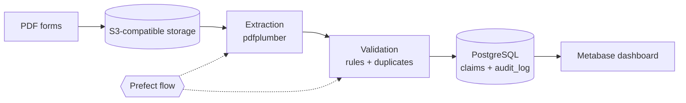
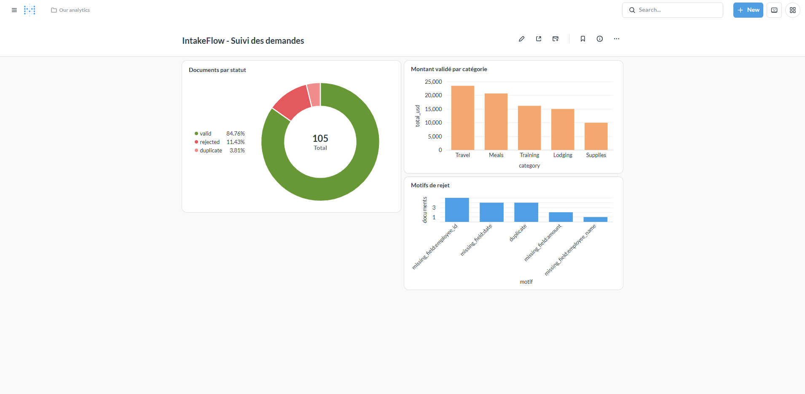

# IntakeFlow

Open-source document intake pipeline. It reads PDF forms from S3-compatible storage, extracts and validates the data, stores the results in PostgreSQL with an audit log, and exposes them in a Metabase dashboard. Orchestrated with Prefect, tested and security-scanned in CI.

The demo use case is an expense reimbursement form, a typical manual-entry workload in public-sector offices. All data in this repository is synthetic.

## Architecture



| Component | Tool | Role |
|---|---|---|
| Storage | SeaweedFS (S3 API) | Document store; same API as AWS S3, so the code is portable |
| Extraction | pdfplumber | Reads text from PDFs and parses the form fields |
| Validation | Python | Required fields, amount and date checks, duplicate detection |
| Database | PostgreSQL 16 | Current state (`claims`) and append-only history (`audit_log`) |
| Orchestration | Prefect | Task retries, run history |
| Dashboard | Metabase | Read-only view of results |
| CI | GitHub Actions | pytest, Bandit, pip-audit, Trivy |

## Dashboard



## Validation rules

A document is classified as `valid`, `rejected` or `duplicate`.

- Rejected: a required field is missing (employee name, employee ID, date, amount), the amount is not positive, or the date is malformed or in the future.
- Duplicate: same employee ID, date, amount and category as an earlier valid document.

Every decision is written to `audit_log`, and loading is idempotent: re-running the pipeline does not create duplicate rows in `claims`.

## Quick start

Requirements: Docker, Python 3.12, Git. Commands below are for Windows PowerShell; on macOS or Linux, adapt the copy and activation commands.

```powershell
git clone https://github.com/Tyannherve11/intakeflow.git
cd intakeflow

# 1. Configuration (never commit these two files)
Copy-Item .env.example .env
Copy-Item config\s3.example.json config\s3.json
# Edit both files: replace every change_me. S3_ACCESS_KEY and S3_SECRET_KEY
# in .env must match accessKey and secretKey in config\s3.json.

# 2. Services (PostgreSQL, S3-compatible storage, Metabase)
docker compose up -d

# 3. Python environment
python -m venv .venv
.venv\Scripts\Activate.ps1
pip install -r requirements.txt

# 4. Generate synthetic documents, upload them, run the pipeline
python src\generate_samples.py
python src\upload_samples.py
python -m flows.intake_flow
```

Expected result: `{'valid': 89, 'rejected': 12, 'duplicate': 4}`.

Metabase is available at http://127.0.0.1:3000. Create a read-only database role for it rather than reusing the main account:

```sql
CREATE ROLE metabase_ro LOGIN PASSWORD '<choose-a-password>';
GRANT CONNECT ON DATABASE intakeflow TO metabase_ro;
GRANT USAGE ON SCHEMA public TO metabase_ro;
GRANT SELECT ON claims, audit_log TO metabase_ro;
```

In Metabase, connect with host `postgres` (the Docker service name), port `5432`.

## Tests and security checks

```powershell
pip install -r requirements-dev.txt
python -m pytest -v
bandit -r src flows -q
pip-audit -r requirements.txt
```

The same checks run in GitHub Actions on every push, plus a Trivy scan for known vulnerabilities and secrets.

Security practices in this repository:

- No secrets in Git: `.env` and `config/s3.json` are ignored, only `.example` templates are committed.
- Services bind to `127.0.0.1` only.
- SQL values are always passed as parameters, never concatenated.
- Metabase uses a read-only database role (least privilege).
- Bandit B311 is ignored only in the synthetic data generator, where a seeded random generator is intentional.

## Measured results

Measured on the 105 synthetic documents (100 forms plus 5 injected duplicates, about 10% of forms with a deliberately missing field):

| Measure | Result |
|---|---|
| Decisions matching the ground truth | 105 / 105 |
| Decisions | 89 valid, 12 rejected, 4 duplicate |
| Processing time, extraction + validation + load | about 1.6 s |
| Unit tests | 8 passing |

How to read these numbers:

- The documents are clean, machine-generated PDFs and the test set was built with the same assumptions as the rules. The results show that the pipeline applies its rules correctly, not how it would perform on real-world scans.
- Four duplicates are reported for five injected: one of the copies duplicates a document that is already rejected for a missing field, so it is rejected first.

### Troubleshooting note: 130 s database connections on Windows

Early runs took about 260 s for the validation script. Measuring each connection showed that connecting to `localhost` took 130 s while `127.0.0.1` took 0.02 s, a name-resolution delay on this Windows setup. Using `127.0.0.1` by default reduced the script from 260 s to 0.63 s.

## Limitations and roadmap

- Extraction reads text-based PDFs directly. Scanned documents (OCR) are not handled yet.
- Runs locally with Docker Compose. A deployment on AWS with OpenTofu, including an infrastructure-as-code security scan, is planned.
- Validation rules are hard-coded; a configurable rules file is a possible next step.

## Project structure


## License

Apache License 2.0. See [LICENSE](LICENSE).
